# Screens

The screens from the low-fi wireframes (phone portrait, 390×844). The rules behind them are in [gameplay.md](gameplay.md) and [dojo.md](dojo.md).

Wireframe source: the project's design canvas (`design/wireframes/*.dc.html` and `canvas.json` in the project files). The screenshots in [`screens/`](screens) are rendered from it. They are low-fi and some labels predate later decisions (for example "too slow" is now "unanswered", and there is no `+64 speed` bonus any more); where a screenshot and the text differ, the text wins.

## Flow

```text
1 Title ──► 2 Fight setup ──► 3 Running ──► 4 Ambush ──► 5 Outcome ──► 3 Running …
   │                              │                                   │
   │                              └─► 6 Pause                         ├─► 7 Finished
   │                                                                  └─► 8 Fallen
   └─► D1 Dojo ──► D2 Study
              └──► D3 Practice start ──► D4 Practice ambush ──► D5 Practice miss
```

## Main game

### 1 Title / menu

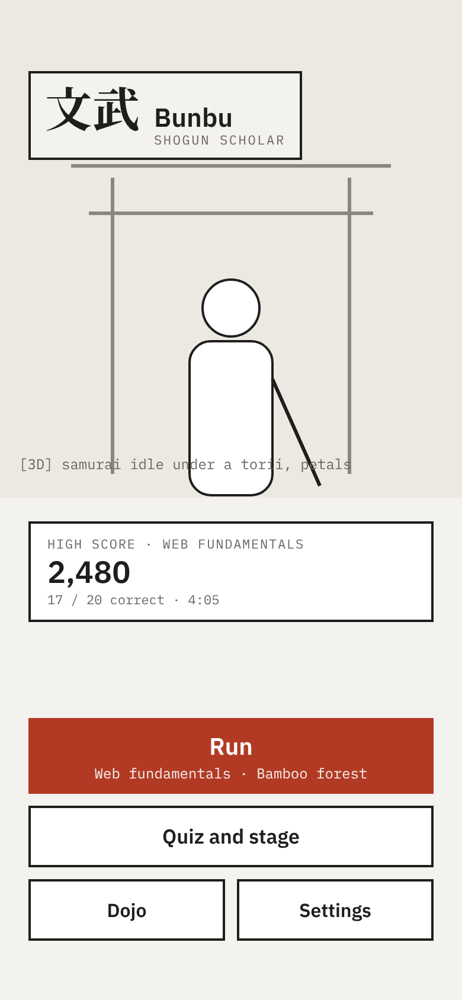

- 3D samurai idling under a torii, falling petals.
- 文武 · **Bunbu** · Shogun Scholar.
- The quiz card. While the saved quizzes come back it says **Loading…**; without a quiz it has one red **Select quiz**, which leads to Quizzes. With one: its title, and its high score `2,480` with `17 / 20 correct · 4:05` (or "No high score yet"), and **Share**, which sends the quiz on as a `.bunbu` file ([sharing](data-format.md#sharing)): the share sheet where the browser says it takes the file (`navigator.canShare`). Otherwise a scroll explains how to share by hand, without saying why: a friend needs the quiz and Bunbu, so **Download the quiz**, **Share Bunbu** (a link to the game; copied where there is no share sheet), and they load the file under Quizzes. **Close** leaves it. Under that, on the card: **Fight**, and **Change quiz** under it.
- **Dojo**, **How to play** and **Settings** in a row, and the credits as a link, "About the Bunbu app".

### 1b Quizzes

A screen of its own, so the title stays calm:

- An area to drop a `.yaml` or `.bunbu` file on, or tap to choose one.
- Why a file didn't load (by line), and which questions of the chosen quiz won't fit in a fight.
- The loaded quizzes as cards, one under the other, with title, `version`, pass mark and best score (`v3 · pass 70% · best 2,480`, or `new`). Tapping one chooses it. Two square red buttons with an icon and a small label sit side by side on each card: **Download** saves its `.bunbu` file, **Remove** asks first, on a scroll with **Remove** and **Cancel**; its high score and stage results stay, so they're back if it's loaded again.

### 2 Fight setup

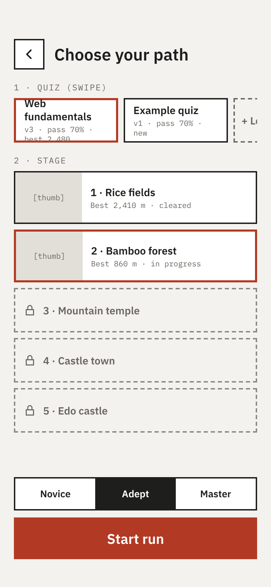

"Choose your path". The quiz is chosen on Quizzes (1b); the stage and the difficulty only matter to a fight, so they are chosen here:

1. **Quiz:** the chosen quiz, and which of its questions won't fit in a fight.
2. **Stage:** Rice fields, Bamboo forest, Mountain temple, Castle town, Edo castle. Each shows the best distance with the chosen quiz and whether it was cleared (`Best 860 m`, `Best 1,440 m · cleared`), or nothing before its first run. A stage is as long as the quiz, so this is per quiz.

A difficulty slider from **Apprentice** to **Shogun** over four stops (Apprentice, Samurai, Daimyo, Shogun), the inner two marked (sets `timeScale`, see [time limit](gameplay.md#time-limit)). Under it, the stop, and the time it gives when the quiz sets `timePerQuestion`: `Daimyo: 2m 24s per question`. Then **Start run**.

### 3 Running

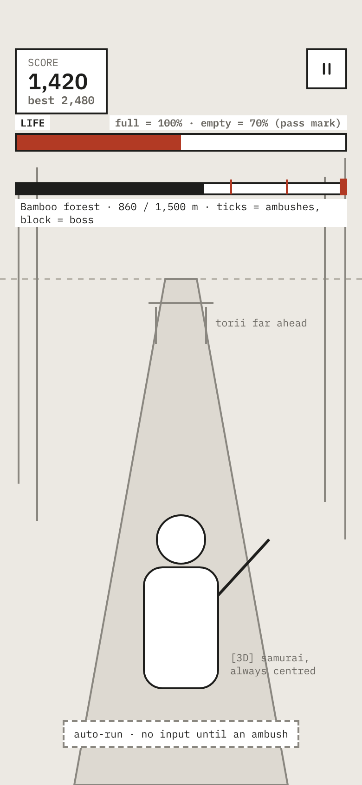

- 3D samurai, always centred, auto-running toward a torii. No input until an ambush.
- HUD: **score** with best to beat, **life bar** (full = 100%, empty = the pass mark), and a **pause** button.
- Progress bar: stage name and the questions done (`Castle town · 7 / 40`). A notch marks each quarter of the stage, and a block marks the boss. Passing a notch moves the stage's time of day on, fading over a few seconds: castle town goes from dusk to night as its shops and lanterns light up.

### 4 Ambush

All variants: the duel strip above the scroll (the samurai and a ninja walking toward each other), the scroll with the question down to the room where the fight shows below it, or to the bottom of a short screen, and the answer drawer at its foot: closed, an edge with the red hanko seal (答) and "Tap or swipe up to answer"; drawn, the answers on lined paper over the whole scroll, a brush-lettered line on how to answer above them, and "Tap or swipe down to read the question" over the seal. The finger leaves a trace on the answers, and each pick splits its answer along a thin red cut. Slow motion, no timer bar; the life bar and stage progress hide behind the strip. See [ambush](gameplay.md#ambush) and [time limit](gameplay.md#time-limit).

The scroll's heading is the label, the question type, `2 OF 3` for the rounds of `solutions` and `match`, `CHOOSE n` for `multiple`, and the ninjas (`7 OPTIONS · 5 NINJAS` when some carry two). `yes-no` is always one ninja and doesn't say so.

- **4A single:** `AMBUSH · SINGLE · 3 NINJAS`, options on ← ↑ →, "Cut your answer".
- **4B solutions / yes-no:** `AMBUSH · SOLUTIONS · 2 OF 3`, scenario on the scroll, one ninja, ↑ yes (slash) / ↓ no (block).
- **4C multiple / order:** `AMBUSH · MULTIPLE · CHOOSE 2`. Picked answers are cut through. Hint: "Cut the 2 you choose, then hold still" (lifting and holding still strikes). A swipe is final: swiping a cut answer again does nothing. For `order` ("Cut them in order, then hold still") the place each answer was cut in is brushed next to it.
- **4D many options:** `AMBUSH · 7 OPTIONS · 5 NINJAS`. Each option lists its mark; which ninja carries it isn't shown. 8 directions; front 3 strike in wave 1, back 2 in wave 2.

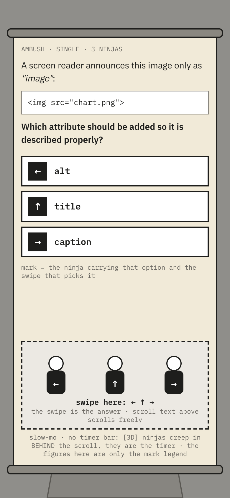 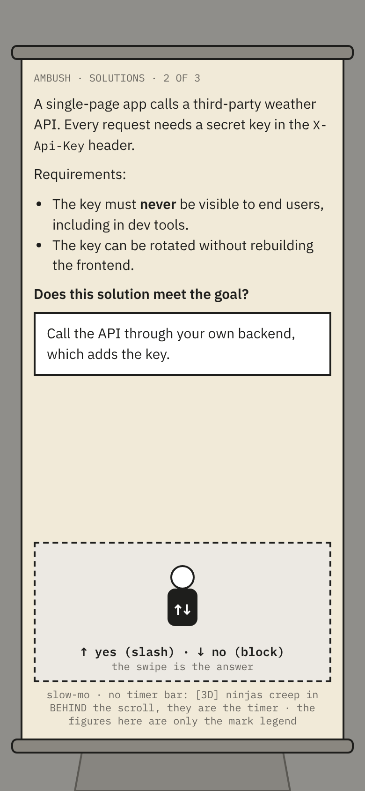 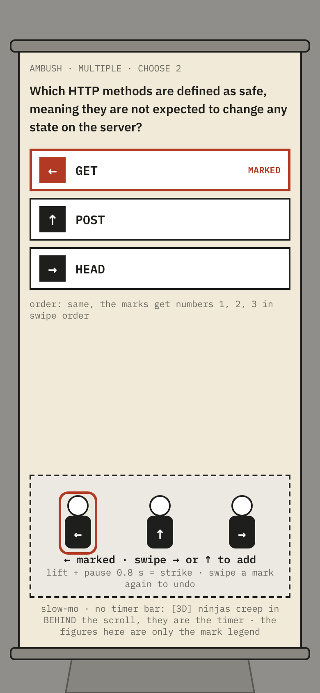 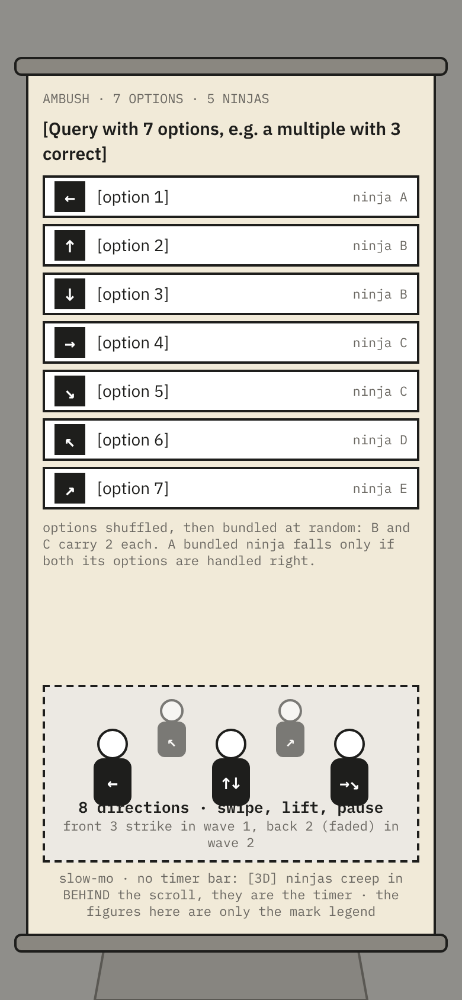

### 5 Outcome

- **5A Correct:** `+100`. The scroll rolls up, slow motion snaps back. One ninja after another, in the order they were answered: picked ninjas slain, the others blocked with a white flash where the blades meet, then fleeing.
- **5B Wrong:** score `+0`, the lost chunk of the life bar flashes and drops off, red edge flash, haptic buzz (can be turned off in settings, and is greyed out there where the phone or browser can't buzz). Ninjas handled wrong land their hit and vanish; the others are still slain or blocked, one after another. Then the run resumes.
- **5C Unanswered:** time ran out. The front ninja leaps in straight ahead, slicing through the scroll with a white cut, and stands mid screen as the halves of the scroll fall away. Then they all charge in with a leap, the front one from mid screen, and hit (one hit), and the run resumes.

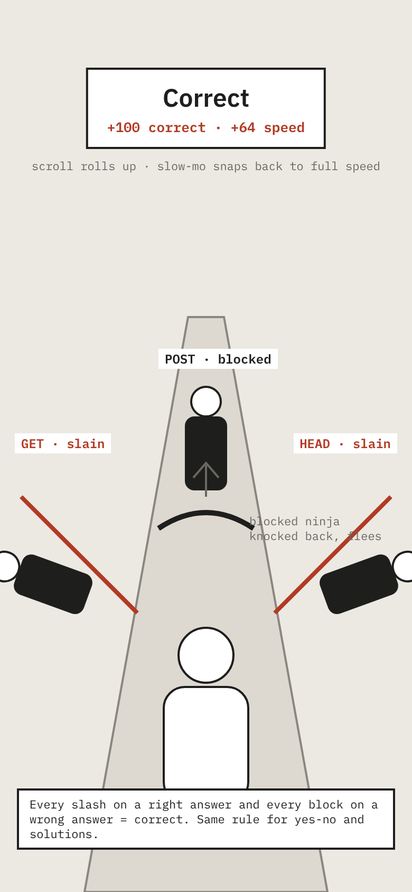 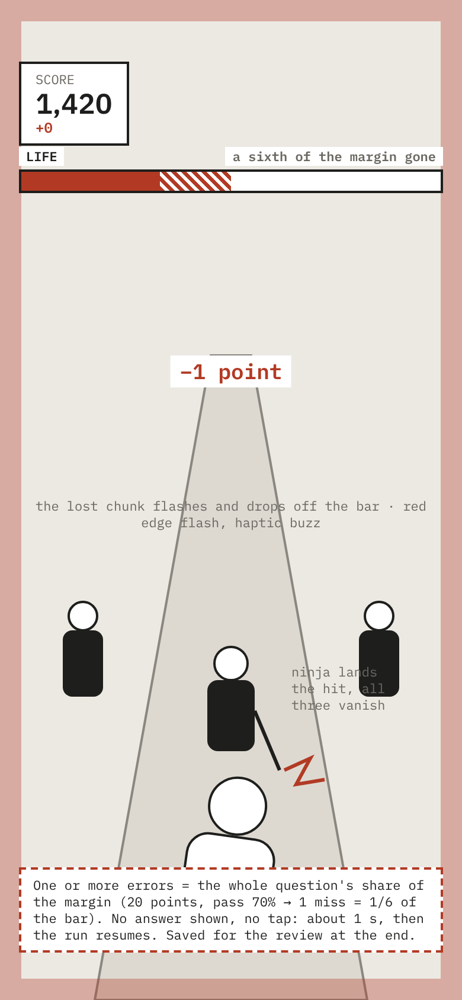 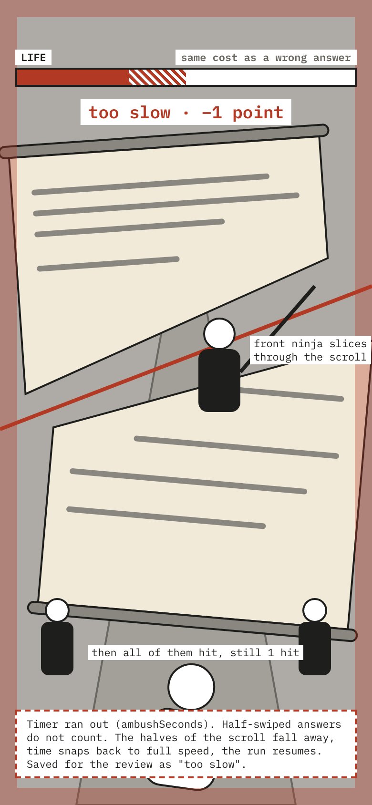

### 6 Pause

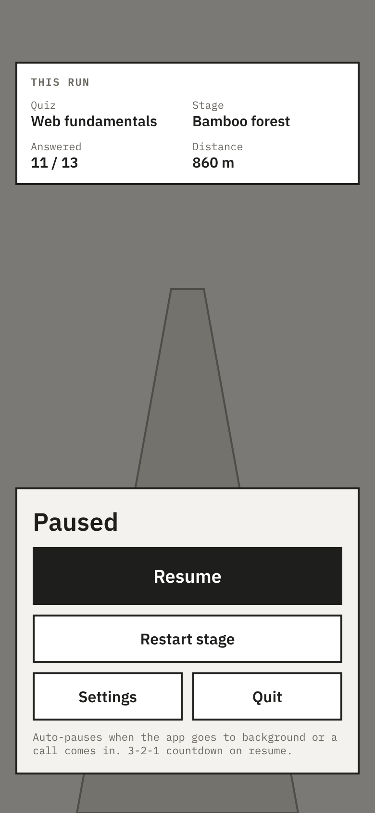

All on a scroll over the dimmed world, like an ambush:

- This run: quiz, stage, answered (`11 / 13`), distance.
- **Resume**, **Restart stage**, **Settings**, **Quit** at the foot of the scroll. Settings open in place on the scroll; the difficulty only shows there, since it can't change halfway through a run.
- Auto-pauses when the app goes to the background or a call comes in. 3-2-1 countdown on resume.
- Also pauses on **Back** and when the player leaves full screen. On a phone (a touch screen without a mouse or trackpad) a run, and [practice](dojo.md#practice), plays full screen; resuming goes full screen again, and **Back** while paused leaves the run. The screen stays on during a run and practice, full screen or not, so it doesn't dim or lock mid fight. **Quit** here, and **Menu** or **Practise mistakes** on the results, go to the title (or the dojo) in the run's place in history, so Back from there never goes into the run again.

### 7 Finished: results and mistakes

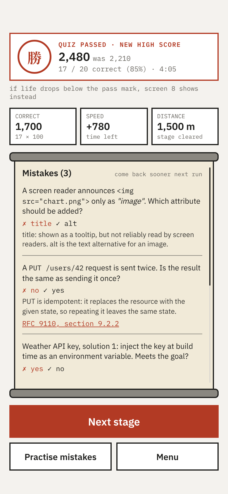

One scroll over the world holds all of it; the buttons stay at its foot while the rest scrolls.

- 勝 · `QUIZ PASSED · NEW HIGH SCORE` · score, with the previous best (`was 2,210`).
- `17 / 20 correct (85%) · 4:05`.
- Breakdown: **Correct** (`17 × 100`), **Time** (tiebreak for the high score), **Distance** (stage cleared).
- **Mistakes**: each miss with ✗ your pick, ✓ the right answer, the explanation and references.
- **Next stage**, **Practise mistakes**, **Menu**.

### 8 Fallen

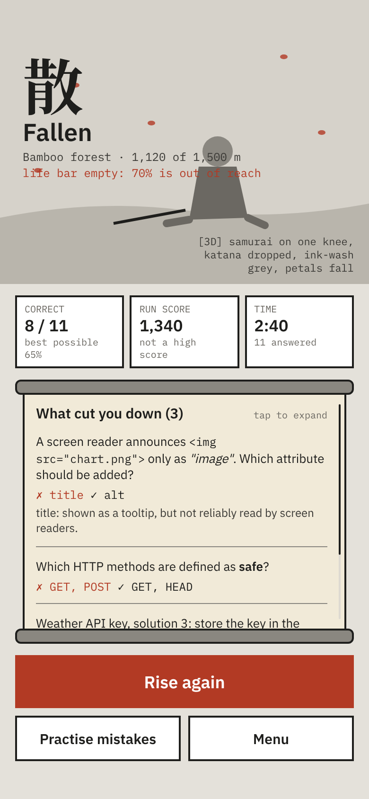

Shown instead of 7 when the life bar is empty, on the same kind of scroll.

- 散 · **Fallen** · stage and distance reached (`1,120 of 1,500 m`) · "life bar empty: 70% is out of reach".
- 3D: a ninja runs in and runs the samurai through. He goes down in ink-wash grey, and his helmet is knocked off and rolls away, still in its colours. Petals falling.
- Correct (`8 / 11`, best possible 65%), **run score** (marked "not a high score"), time.
- "What cut you down": the mistakes, tap to expand.
- **Rise again**, **Practise mistakes**, **Menu**.

## Dojo

See [dojo.md](dojo.md) for the rules.

### D1 Dojo menu

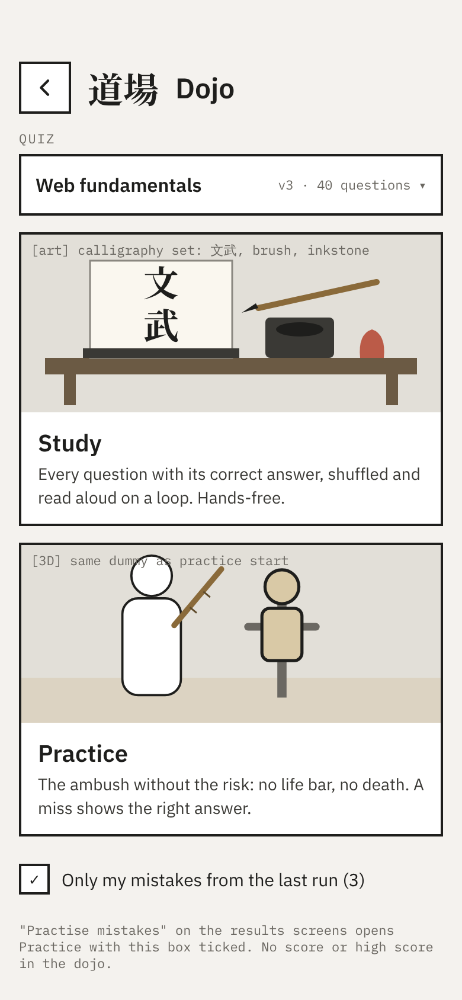

- 道場 · **Dojo** · quiz picker (`v3 · 40 questions`).
- **Study** card, with calligraphy-set art (文武, brush, inkstone).
- **Practice** card, with the training dummy from D3.
- Checkbox **Only my mistakes from the last run (3)**.

### D2 Study

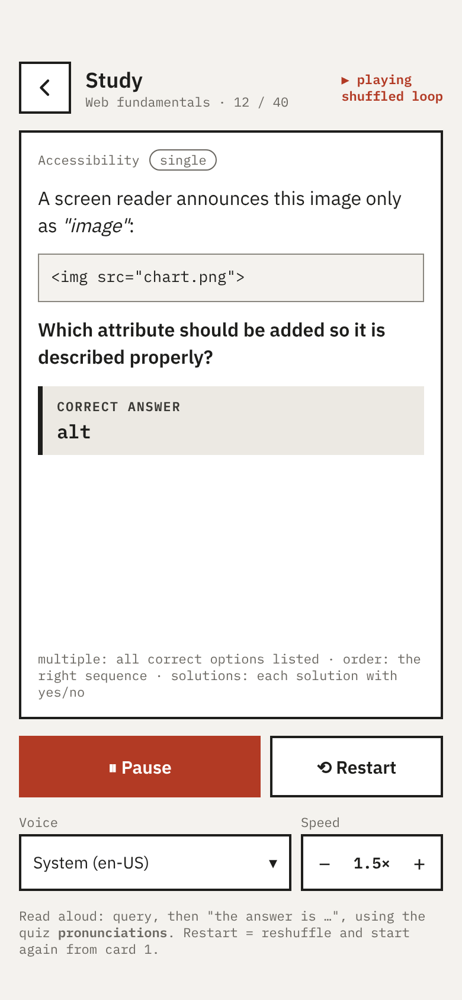

- Progress (`12 / 40`), `▶ playing · shuffled loop`.
- The word being spoken is highlighted: grey background and underline.
- Card: category, type, query, and **Correct answer**. `multiple` lists all correct options, `order` the right sequence, `solutions` each solution with yes/no.
- **Pause**, **Restart**, **Voice** (`System (en-US)`), **Speed** (`− 1.5× +`).

### D3 Practice start

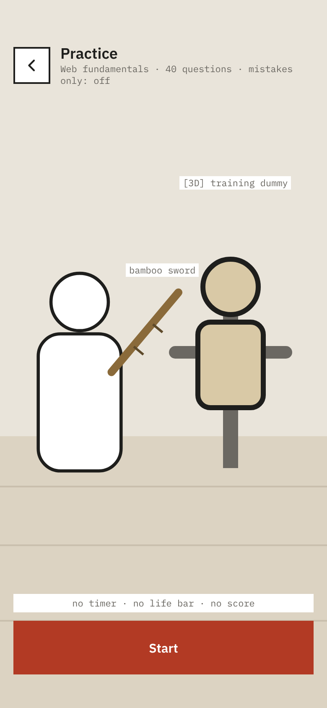

- Quiz, question count, "mistakes only: off".
- 3D training dummy holding a bamboo sword. "no timer · no life bar · no score".
- **Start**.

### D4 Practice ambush

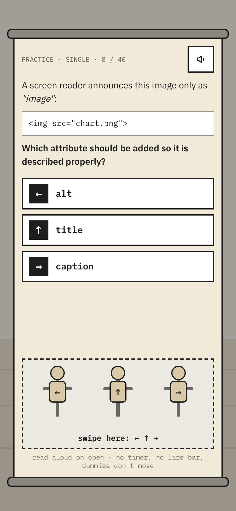

Like 4A, with `PRACTICE · SINGLE · 8 / 40` and the running right vs wrong percentage. A speaker button reads the card aloud. No timer, no life bar, the dummies don't move.

### D5 Practice miss

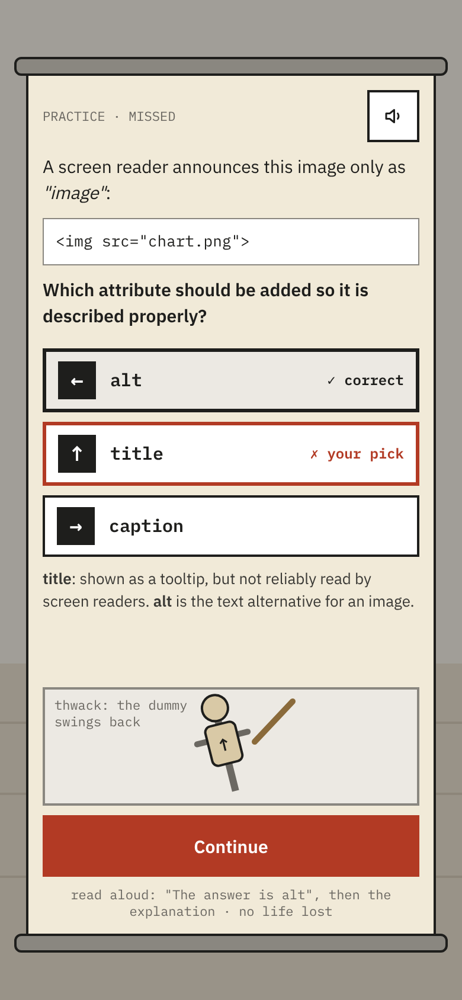

- `PRACTICE · MISSED`. The options show ✓ correct and ✗ your pick, followed by the explanation.
- The dummy swings back: thwack.
- Speaker button reads "The answer is alt", then the explanation. No life lost.
- **Continue**.

## Notes

- The difficulty slider on screen 2 maps to `timeScale`: Apprentice `1.2`, Samurai `1` (the default), Daimyo `0.8`, Shogun `0.5`.
