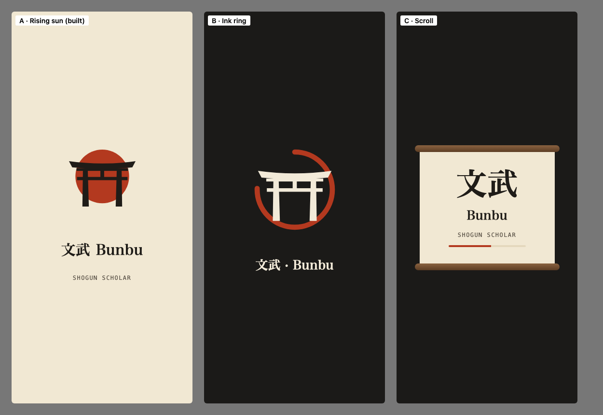

# Screens

The screens from the low-fi wireframes (phone portrait, 390×844). The rules behind them are in [gameplay.md](gameplay.md) and [dojo.md](dojo.md).

Wireframe source: the project's design canvas (`design/wireframes/*.dc.html` and `canvas.json` in the project files). The screenshots in [`screens/`](screens) are rendered from it. They are low-fi and some labels predate later decisions (for example "too slow" is now "unanswered", and there is no `+64 speed` bonus any more); where a screenshot and the text differ, the text wins.

## Flow

```text
0 Loading ──► the screen opened, usually 1 Title

1 Title ──► 2 Fight setup ──► 3 Running ──► 4 Ambush ──► 5 Outcome ──► 3 Running …
   │                              │                                   │
   │                              └─► 6 Pause                         ├─► 7 Finished
   │                                                                  └─► 8 Fallen
   └─► D1 Dojo ──► D2 Study
              └──► D3 Practice start ──► D4 Practice ambush ──► D5 Practice miss
```

## Main game

### 0 Loading



- Whenever Bunbu opens, on any screen: the app icon on papyrus, the torii in ink with the red sun rising behind it and sinking again, and under it 文武 · **Bunbu** · Shogun Scholar. It is in the page itself, so it shows from the first paint.
- It fades out once the screen has settled: the saved quizzes are back, the fonts are in and its world's models have loaded (or failed). That way the buttons and the 3D scene don't flicker in one by one. It never stays longer than 6 seconds.
- The tab's icon (`favicon.svg`) is the same picture on a rounded tile, without the ground.
- Of the three designs, A is the one built; B (the sun as an ink ring on the night) and C (a scroll with a loading bar) were left.

### 1 Title / menu


- 3D samurai idling under a torii, falling petals. He stands in the gap between the name and the menu, a little below its middle, on any phone and on a laptop: on a short screen the camera steps back until he fits, and the name and the menu close up. The gap is at least 8rem: a long quiz title makes the screen scroll rather than squeeze him out. `pnpm e2e` checks this on a set of phones, a tablet and a laptop.
- 文武 · **Bunbu** · Shogun Scholar.
- The quiz card. While the saved quizzes come back it says **Loading…**; without a quiz it has one red **Select quiz**, which leads to Quizzes. With one: its title, and its high score in two small lines, `high score · 2,480 · shogun` (the difficulty it was set at) and `correct · 17 / 20` (or "No high score yet"), and **Share**, which sends the quiz on as a `.bunbu` file ([sharing](data-format.md#sharing)): the share sheet where the browser says it takes the file (`navigator.canShare`). Otherwise a scroll explains how to share by hand, without saying why: a friend needs the quiz and Bunbu, so **Download the quiz**, **Share Bunbu** (a link to the game; copied where there is no share sheet), and they load the file under Quizzes. **Close** leaves it. Under that, on the card: **Fight**, and **Change quiz** under it.
- **Dojo**, **How to play** and **Settings** in a row, and the credits as a link, "About the Bunbu app".

### 1b Quizzes

A screen of its own, so the title stays calm:

- A square red **Load quiz** button with an upload icon, with a line on what a quiz file is at its left, to choose a `.yaml` or `.bunbu` file, and under it an area that says a file can be dropped. Dragging a file over the screen makes that area cover the whole screen, so the file can be dropped anywhere; it shrinks back on drop, when the file leaves the window, or on Escape. Touch phones don't drag files, so they only show the button.
- A quiz file can also come in from outside, once Bunbu is installed: on a computer (Chrome or Edge) a `.bunbu` file opens with Bunbu, and on Android a quiz file can be shared to Bunbu. Either way Bunbu opens on this screen and loads it as if it was chosen with **Load quiz**. iPhones and iPads, Safari and Firefox don't let a web app do either, so there only **Load quiz** works.
- Why a file didn't load (by line), which questions a loaded `.yaml` file asked more than once (by line, left out, so the quiz keeps each question once; see [Common fields](data-format.md#common-fields)), and which questions of the chosen quiz won't fit in a fight. Only `.yaml`, `.yml` and `.bunbu` files are read: a `.yaml` file must start with the schema line and a `.bunbu` file with Bunbu's own first bytes, or it is not a quiz.
- The loaded quizzes as cards, one under the other, with title, `version`, pass mark and best score (`v3 · pass 70% · best 2,480`, or `new`). Tapping one chooses it. Two square red buttons with an icon and a small label sit side by side on each card: **Download** saves its `.bunbu` file, **Remove** asks first, on a scroll with **Remove** and **Cancel**; its high score and stage results stay, so they're back if it's loaded again.

#### Terms

A quiz only joins the list once the player agrees to its terms, on a scroll with **I agree** and **Cancel**; Cancel (or Escape) leaves the quiz out. The terms are Markdown files with a `title` and a `version` in their frontmatter, in `apps/game/src/_shared/terms/`:

- A `.yaml` quiz is one the player made (`written-quiz.md`): it is theirs to make and, when shared, theirs to share; its content was collected through legitimate means; they are responsible for what it says.
- A `.bunbu` quiz was shared with them (`shared-quiz.md`): they got it through legitimate means; they are responsible for what it says.

What was agreed is kept per quiz `id` + `version`, with the quiz's content and the terms' `version`. Loading the same quiz again asks again only when its content or the terms changed. When Bunbu opens and the terms changed since the player agreed to them, it asks again, once per set of terms, for every quiz agreed to under the old version: **I agree** keeps them, **Remove** takes them off the list, as Remove does.

### 2 Fight setup


"Choose your path". The quiz is chosen on Quizzes (1b); the stage and the difficulty only matter to a fight, so they are chosen here:

1. **Quiz:** the chosen quiz (`v3 · pass 70% · 40 of 260 per run` when it sets `questionsPerTest`), and which of its questions won't fit in a fight.
2. **Stage:** Rice fields, Bamboo forest, Mountain temple, Castle town, Edo castle, as a carousel of cards that scrolls sideways, swiped with a finger or dragged with a mouse, the chosen one in the middle with its neighbours peeking in. Each card has a picture of the stage as the run sees it, without the samurai or the ninjas (`public/stages/`, taken with `pnpm --filter @bunbu/game stage-pictures`; CI fails when they are out of date), then its number and name. Each shows the best distance with the chosen quiz and whether it was cleared (`Best 860 m`, `Best 1,440 m · cleared`), or `Not run yet` before its first run. A stage is as long as the test, so this is per quiz. A stage that is still locked ([stages](gameplay.md#stages)) can't be chosen: its picture is in ink-wash grey, a lock covers its number and it says `Clear Rice fields to unlock`. When the chosen stage is locked for the chosen quiz, the furthest open one is chosen instead.

A difficulty slider from **Apprentice** to **Shogun** over four stops (Apprentice, Samurai, Daimyo, Shogun), the inner two marked (sets `timeScale`, see [time limit](gameplay.md#time-limit)). Under it, the stop, and the time it gives when the quiz sets `timePerQuestion`: `Daimyo: 2m 24s per question`. The difficulty is chosen here only, never in the settings, and kept per quiz (`id` + `version`): each test has its own, Samurai until another is chosen. Then **Start run**.

In dev builds only, one button under the stages toggles them for the chosen quiz: **Unlock all stages** while any is locked, **Lock all stages** (which clears their results) once all are open, to try them without playing them.

### 3 Running


- 3D samurai, always centred, auto-running toward a torii. No input until an ambush.
- The run starts once the stage has loaded. Until then the samurai waits out of view, behind the camera; then he runs in to his place and the stage starts.
- HUD: **score** with best to beat, **life bar** (full = 100%, empty = the pass mark), and a **pause** button.
- Progress bar: stage name and the questions done (`Castle town · 7 / 40`). A notch marks each quarter of the stage, and a block marks the boss. Passing a notch moves the stage's time of day on, fading over a few seconds: castle town goes from dusk to night as its shops and lanterns light up. Each quarter is also a **district** of its own, with its own backdrop and things by the way, fading into the next over about 90 m around the notch:

  | Stage | Districts |
  | --- | --- |
  | Rice fields | village edge, open paddies, irrigation ponds, shrine grove (torii over the path) |
  | Bamboo forest | deep grove, mossy stones, shrine path (torii and stone lanterns), forest edge |
  | Mountain temple | foothill pines, rock garden, pagoda terrace, snowy heights |
  | Castle town | gate gardens (torii, red maples), shop street, pond and red bridge, castle approach (walls and the keep) |
  | Edo castle | retainers' quarter, castle gardens, pine walk, the keep's approach |

  Some districts have their own things for the ninjas to hide behind ([cover](gameplay.md#ambush)), in place of the stage's crates, barrels, carts, straw and boulders, and the same stand along the way as decoys:

  | District | Covers |
  | --- | --- |
  | Rice fields, village edge | a basket heaped with rice, a scarecrow in a straw coat, straw bales |
  | Rice fields, open paddies | straw bales, a scarecrow |
  | Bamboo forest, deep grove | bundles of cut bamboo, boulders, now and then a panda eating bamboo (a ninja comes from behind one even more rarely) |
  | Bamboo forest, shrine path | bundles of cut bamboo, crates |
  | Mountain temple, pagoda terrace | a temple bell in its roofed frame, barrels, boulders |
  | Castle town, gate gardens | a market stand, crates, a villager with a basket on the back (mostly just there, rarely one a ninja comes from) |
  | Castle town, shop street | a market stand, a cart, barrels, a villager |
  | Edo castle, castle gardens | a palanquin set down, boulders |
  | Edo castle, pine walk | a palanquin, crates |

  A district is at least 5 questions long, so a short test has fewer: 10 questions run through the first and the last, 15 through three. The stage's own streets, fields and paths stay the same throughout.

### 4 Ambush

All variants: the duel strip above the scroll (the samurai and a ninja walking toward each other), the scroll with the question down to the room where the fight shows below it, or to the bottom of a short screen, and the answer drawer at its foot: closed, an edge with the red hanko seal (答) and "Tap or swipe up to answer"; drawn, the answers on lined paper over the whole scroll, a brush-lettered line on how to answer above them, and "Tap or swipe down to read the question" over the seal. The finger leaves a trace on the answers, and each pick splits its answer along a thin red cut. Slow motion, no timer bar; the life bar and stage progress hide behind the strip. See [ambush](gameplay.md#ambush) and [time limit](gameplay.md#time-limit).

The scroll's heading is the label, the question type, `2 OF 3` for the rounds of `solutions` and `match`, `CHOOSE n` for `multiple`, and the ninjas (`7 OPTIONS · 5 NINJAS` when some carry two). `yes-no` is always one ninja and doesn't say so.

- **4A single:** `AMBUSH · SINGLE · 3 NINJAS`, options on ← ↑ →, "Cut your answer".
- **4B solutions / yes-no:** `AMBUSH · SOLUTIONS · 2 OF 3`, scenario on the scroll, one ninja, ↑ yes (slash) / ↓ no (block).
- **4C multiple / order:** `AMBUSH · MULTIPLE · CHOOSE 2`. Picked answers are cut through. Hint: "Cut the 2 you choose"; it strikes as soon as the second is cut. A swipe is final: swiping a cut answer again does nothing. For `order` ("Cut them in order") the place each answer was cut in is brushed next to it, and it strikes as soon as the last item in the order is cut; its distractors are left uncut.
- **4D many options:** `AMBUSH · 7 OPTIONS · 5 NINJAS`. Each option lists its mark; which ninja carries it isn't shown. 8 directions; front 3 strike in wave 1, back 2 in wave 2.

   

### 5 Outcome

- **5A Correct:** `+100`. The scroll rolls up, slow motion snaps back. One ninja after another, in the order they were answered: picked ninjas slain, the others blocked with a white flash where the blades meet, then fleeing.
- **5B Wrong:** score `+0`, the lost chunk of the life bar flashes and drops off, red edge flash, haptic buzz (can be turned off in settings, and is greyed out there where the phone or browser can't buzz). Ninjas handled wrong land their hit and vanish; the others are still slain or blocked, one after another. Then the run resumes.
- **5C Unanswered:** time ran out. The ninja that wound up first slices through the scroll with a white cut from where it stands, and the halves of the scroll fall away. Then it charges in with a leap and lands the hit (one hit) while the others flee, then flees too, and the run resumes.

  

### 6 Pause


All on a scroll over the dimmed world, like an ambush:

- This run: quiz, stage, difficulty, answered (`11 / 13`), distance.
- **Resume**, **Restart stage**, **Settings**, **Quit** at the foot of the scroll. Settings open in place on the scroll; the difficulty isn't one of them, it is chosen before the run on [screen 2](#2-fight-setup).
- Auto-pauses when the app goes to the background or a call comes in. 3-2-1 countdown on resume.
- Also pauses on **Back** and when the player leaves full screen. On a phone (a touch screen without a mouse or trackpad) a run, and [practice](dojo.md#practice), plays full screen (practice doesn't pause); resuming goes full screen again, and **Back** while paused leaves the run. The screen stays on during a run and practice, full screen or not, so it doesn't dim or lock mid fight. **Quit** here, and **Menu** or **Practise mistakes** on the results, go to the title (or the dojo) in the run's place in history, so Back from there never goes into the run again.

### 7 Finished: results and mistakes


One scroll over the world holds all of it; the buttons stay at its foot while the rest scrolls.

- 勝 · `QUIZ PASSED · NEW HIGH SCORE` · score, with the high score it beat (`was 2,210`).
- Under it, as on the title's quiz card: `high score · 2,480 · shogun` and `correct · 17 / 20`.
- Breakdown: **Correct** (`17 × 100`), **Time** (tiebreak for the high score), **Distance** (stage cleared).
- **Mistakes**: each miss with ✗ your pick, ✓ the right answer, the explanation and references.
- **Next stage** (with `Bamboo forest · unlocked` when this run unlocked it; **Run again** after the last stage) with **Practise mistakes** beside it, then **Menu** with a square **Share** beside it. Share dares a friend to beat the score with a picture of the quiz's title, the header and the three tiles, with Bunbu's name and link. It opens the phone's share sheet with the picture; where that can't take a picture, the picture downloads.

### 8 Fallen


Shown instead of 7 when the life bar is empty, on the same kind of scroll.

- 散 · **Fallen** · stage and distance reached (`1,120 of 1,500 m`) · "life bar empty: 70% is out of reach".
- 3D: a ninja runs in and runs the samurai through. He goes down in ink-wash grey, and his helmet is knocked off and rolls away, still in its colours. Petals falling.
- Correct (`8 / 11`, best possible 65%), **run score** (marked "not a high score"), time.
- "What cut you down": the mistakes, tap to expand.
- **Rise again** with **Practise mistakes** beside it, then **Menu**.

## Dojo

See [dojo.md](dojo.md) for the rules.

### D1 Dojo menu


- 道場 · **Dojo** · the chosen quiz (`v3 · 40 questions`), which leads to the quizzes to change it.
- **Study** card, with calligraphy-set art (文武, brush, inkstone).
- **Practice all questions** card, with the training dummy from D3.
- **Practice mistakes** card, with the same dummy, when the last run was on this quiz and version and missed some: `Only the 3 questions you missed in your last run.`, counting questions. It opens practice on `/dojo/practice/mistakes/`.
- Without a quiz the cards can't be opened, and **Select quiz** leads to the quizzes.

### D2 Study


- Progress (`12 / 40`), `▶ playing · shuffled loop`.
- The word being spoken is highlighted: grey background and underline.
- Card: type, query, and **Correct answer**. `multiple` lists all correct options, `order` the right sequence, `solutions` each solution with yes/no, `match` each row with its answer. (Questions have no category in the [data format](data-format.md#common-fields), so the card shows none.)
- The card is text that scrolls on the page. **Pause** (**Play** while paused) and **Skip** are docked at the bottom; a settings button at the top right opens the settings in place, with the **Voice** and the **Reading speed** (a notched slider, `1.5x speed`). The wireframe's scroll, Restart and the controls under the card are gone.

### D3 Practice start


- Quiz, question count, "mistakes only: off".
- 3D training dummy holding a bamboo sword. "no timer · no life bar · no score".
- **Start**.
- Back goes back through the history, as every back link does: to the dojo menu when practice was opened from there, to the title when there is no page before it.

### D4 Practice ambush


Like 4A, with `PRACTICE · SINGLE · 8 / 40` and the running right vs wrong percentage. No timer, no life bar, no pause, the dummies don't move.

- On top, in a row: the back link, which leaves practice, and `✓ 6 · ✗ 2 · 75% right`.
- At the end of the question, in brush lettering: **🔉 read out loud**, which reads the query and the options and stops when pressed again (it says **stop reading** then) or when the scroll closes.
- After the last question: **Practice done** with the final percentage and the right and wrong count, then **Again** (the same questions reshuffled, a fresh count) and **Dojo**.

### D5 Practice miss


- `PRACTICE · MISSED`. The options show ✓ correct and ✗ your pick, followed by the explanation.
- The dummy swings back: thwack.
- **read out loud** at the end reads "The answer is alt", then the explanation, and stops on **Continue**.
- **Continue**.
- For `order` each item shows its right place, and the place given when that was wrong (`2nd, not 3rd`); an item that is not in the order at all shows the place it was given (`not in the order, not 4th`). The explanations are the ones the mistakes on the results show: the picked option's, the right option's, then the question's.

## Notes

- The difficulty slider on screen 2 maps to `timeScale`: Apprentice `1.2`, Samurai `1` (the default), Daimyo `0.8`, Shogun `0.5`.
